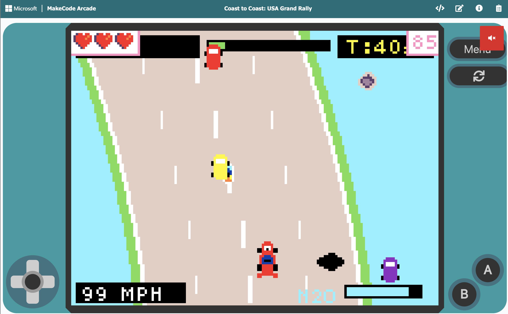

# Coast to Coast: USA Grand Rally

> Built at an IBM volunteer event on **November 5, 2026** in San Jose, California, in support of **[Sacred Heart Community Service](https://sacredheartcs.org)**.

## ▶️ Play It

**[Play Coast to Coast in your browser](https://arcade.makecode.com/S34315-50868-70857-77989)**

No install needed. The game runs in the MakeCode Arcade simulator. Use the arrow keys to drive, **Space/Z** for nitro (A) and **X** to brake (B). To edit the code, click **Edit Code** on that page.

## About This Project

This game was made during the IBM volunteer event **"Assemble a Micro:bit-based Game Designer Kit and vibe code a game for students,"** held at the IBM Silicon Valley Lab in San Jose.

Volunteers worked in teams of three per kit to:

1. **Assemble** a Micro:bit-based Game Designer Kit (handheld console with a D-pad, A/B buttons and a color screen).
2. **Vibe code** a starter game for the console using Microsoft MakeCode Arcade.
3. **Donate** the finished console to Sacred Heart Community Service, so students can play, explore, and eventually build games of their own.

The aim of the program is to help students move from *consuming* video games to *creating* them.

## The Game

Coast to Coast is a top-down racing game built in Microsoft MakeCode Arcade. The player races across America from west to east in four stages, and each stage puts them in a different vehicle on a different kind of road:

- **Pacific Coast Highway, California:** an F1 car on cliffside asphalt with oil slicks.
- **Mojave Canyon Trail, Nevada:** a 4x4 desert truck on dirt, with mud bogs, rocks and cacti.
- **Heartland Interstate 80, Midwest:** a semi-truck on a busy concrete highway.
- **Broadway Metro Dash, New York City:** a twin-turbo GT car on night streets packed with traffic.

The player steers and controls throttle with the D-pad, uses **A** for a nitro boost from a refilling fuel gauge, and uses **B** to brake hard. The road curves all the time and pulls the car outward on bends, so the player has to keep correcting. Civilian traffic changes lanes, hazards land on the road, and the shoulders are lined with obstacles. Going off the road cuts your speed.

Each stage has a target time. Crossing the checkered finish line under it earns bonus points for every second you saved. The player starts with 3 lives:

- Crashing into traffic, hazards or shoulder obstacles costs a life.
- Mud bogs only slow you down.
- Pickups help along the way: nitro canisters refill boost, stars add points, and wrenches restore a life.

**Win:** finish all four stages to become Coast-to-Coast Champion.

**Lose:** run out of lives.

The project uses only built-in MakeCode Arcade APIs: hand-drawn pixel-art sprites, a road drawn every frame with curves, and a live HUD showing the stage timer, target time, progress bar, speedometer and nitro gauge.

## Tools Used

- **[Microsoft MakeCode Arcade](https://arcade.makecode.com/)**: game engine, code editor and browser simulator.
- **[Sprite Maker Lab](https://sprite-maker-lab.emergent.host/design/p_mw44r9wf_gmhqjh)**: used to design the pixel-art sprites (vehicles, traffic, hazards and pickups).
- **Micro:bit Game Designer Kit**: the handheld console the game was built for and donated with.

## Event Details

| | |
|---|---|
| **Event** | Assemble a Micro:bit-based Game Designer Kit and vibe code a game for students |
| **Date** | November 5, 2026 |
| **Location** | IBM Silicon Valley Lab, San Jose, CA |
| **Nonprofit** | Sacred Heart Community Service |
| **Organized by** | IBM Volunteering |
